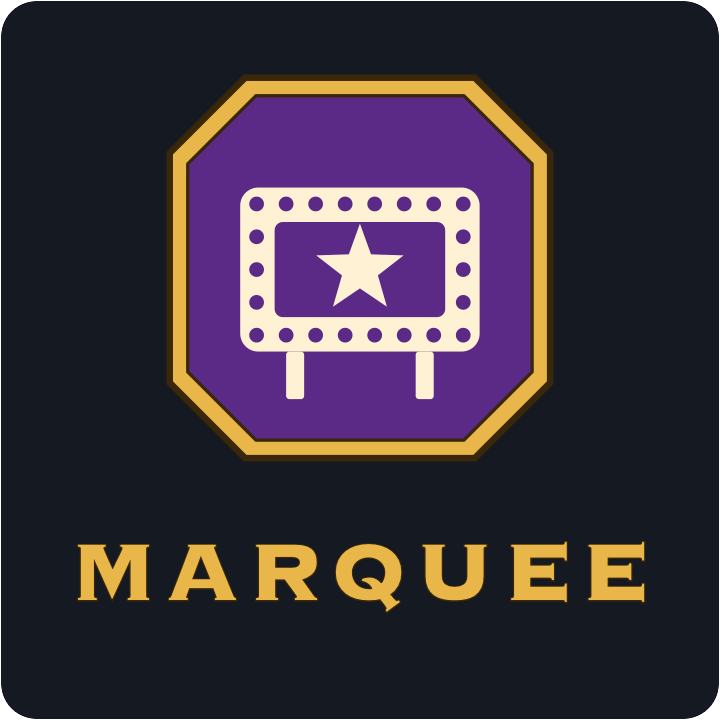

<p align="center"></p>

# Marquee

A simpler way to choose your title in World of Warcraft (Retail). Marquee works inside Blizzard's
Character window: it improves the Titles list that's already there instead of adding a window of
its own, and looks and feels like the rest of the game's interface.

**Status:** early development.

## Features

### Titles list

- **Search** your titles by name.
- **Filter** them by expansion and by activity (raids, dungeons, Delves, PvP, world events,
  reputation, quests, professions and more), like the Pet Journal's Filter button. The filters are
  saved; the Filter button's reset shows all titles again.
- Titles are cards; the one you wear has a gold outline. Lines divide the list into No Title and
  Random, your favourites, and your other titles.

### Favourites

- Click a title's star to make it a favourite. Favourites come first, right after No Title.
- Favourites are shared by your characters. A character can keep its own instead: the gear next to
  the search box, **Own favorites for this character**.

### Random titles

- **Random** and **Random Favorite** below No Title wear a random title, or a random favourite.
- `/marquee random` and `/marquee random favorite` do the same, e.g. from a macro.

### A title for each outfit

- In the transmog window, **Title** at the top right of the character preview shows the outfit's
  title. Click it to choose one from a list like the Titles list (filters, search, favourites).
- Putting the outfit on wears its title: in the transmog window (clicking the outfit, or saving
  changes to it), or with the outfit on Blizzard's action bars (click or key). Choosing a title for
  the outfit you're wearing wears it right away. The outfit's tooltip shows its title.
- The game only lets addons change your title from a click or key press, so outfits the game
  switches to by itself don't change the title. Neither does using an outfit while it's on
  cooldown.

### Settings

The gear next to the search box has this character's settings, and opens Marquee's settings for
all your characters in Blizzard's Options (AddOns tab).

## Installation

Copy the `Marquee` folder into `World of Warcraft/_retail_/Interface/AddOns/` and restart the game.

Open the Character window (`C`) and its Titles tab, or type `/marquee`.

## Commands

| Command                    | Description                                  |
|----------------------------|----------------------------------------------|
| `/marquee`                 | Open the Character window on the Titles list |
| `/marquee random`          | Wear a random title                          |
| `/marquee random favorite` | Wear a random favorite title                 |
| `/marquee debug`           | Turn debug messages on or off                |

## Languages

Marquee uses the language of your game client. English, German, French, Italian and Russian are
available; translations are in `Locales/`.

**Help with translations is welcome:** if your language is missing or a text reads wrong, open an
[issue](https://github.com/remul/Marquee/issues) or a pull request. To add a language, copy
`Locales/deDE.lua`, change the locale code (e.g. `esES`), translate the text on the right of each
line and add the file to `Marquee.toc`.

## Development

Marquee is Lua with no build step. Link the repository into the AddOns folder and use `/reload` in
game to load changes:

```sh
ln -s "$(pwd)" "/Applications/World of Warcraft/_retail_/Interface/AddOns/Marquee"
```

Each title's expansion and activity is in `Data/TitleData.lua`, generated from Blizzard's game
data: titles an achievement rewards take its category, the others are tagged by name rules and by
hand. After a patch that adds titles, run `python3 tools/generate_title_data.py` (it downloads the
current tables from [wago.tools](https://wago.tools)), tag the titles it lists in the script's
`OVERRIDES`, and commit the result.

Releases are built by the [BigWigs packager](https://github.com/BigWigsMods/packager) (see
`.pkgmeta`) when a version tag is pushed. Before tagging, set `## Version` in `Marquee.toc` to the
same version. Changes are listed in [CHANGELOG.md](CHANGELOG.md); planned features, ideas and known
issues in [ROADMAP.md](ROADMAP.md).

## License

[MIT](LICENSE)
