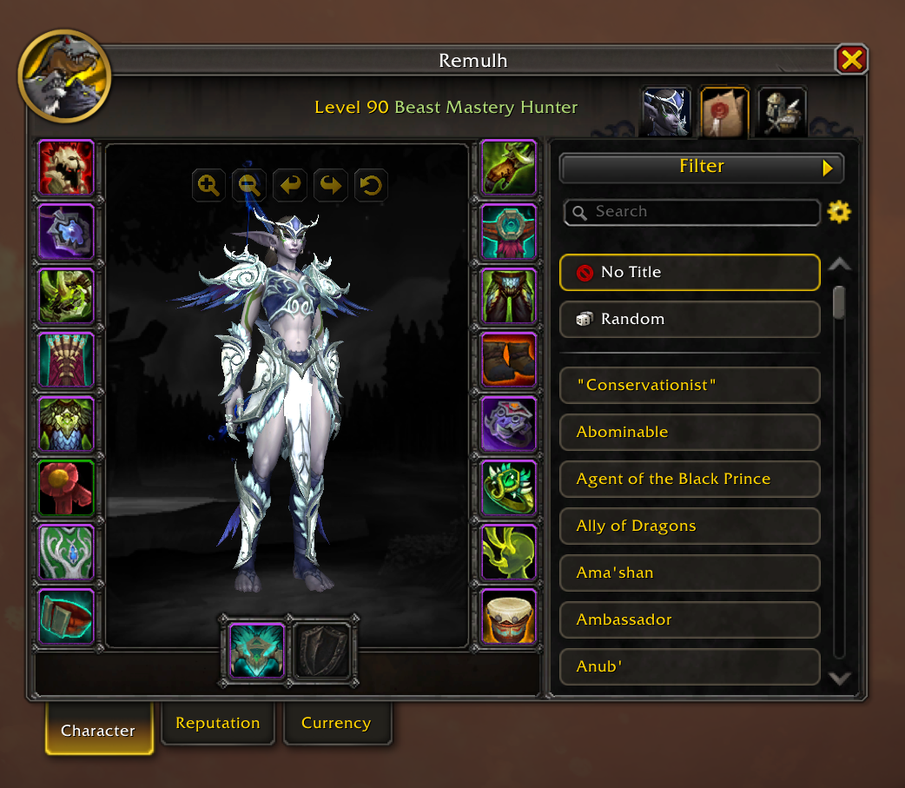

# Marquee

Marquee makes it easier to pick a title in World of Warcraft (Retail). It adds to the Titles list
in your Character window, so there's no new window to open.

## What it does

- **Search** your titles by name, expansion or activity. Press Enter to wear the first title
  found.
- **Filter** your titles by expansion and by activity, like raids, dungeons, Delves, PvP or
  reputation.
- **Sort** your titles by name, expansion or activity.
- **Favorites:** click the star on a title to keep it at the top of the list. Favorites are shared
  by all your characters, or each character can have its own.
- **Hide titles** you never want to see: right-click a title, then Hide. The Filter menu can
  show them again.
- **Random title:** wear a random title, or a random favorite, with one click.
- **A title for each outfit:** in the transmog window, or by right-clicking a title, pick a title
  for an outfit. When you put the outfit on, you wear its title too. This works from Blizzard's
  action bars, Bartender, Dominos and ElvUI.

## How to use it

Open your Character window (`C`) and go to the Titles tab, or type `/marquee`.

The gear next to the search box has the settings. More settings are in Blizzard's Options, on the
AddOns tab.

## Commands

| Command                    | What it does                       |
|----------------------------|------------------------------------|
| `/marquee`                 | Open the Titles list               |
| `/marquee random`          | Wear a random title                |
| `/marquee random favorite` | Wear a random favorite title       |

The random commands also work in a macro.

## Good to know

- The game only lets addons change your title when you click or press a key. If the game changes
  your outfit by itself, Marquee waits for your next key press or click, then wears the outfit's
  title. In the settings you can have Marquee ask first instead.
- Your title never changes during combat. It changes when the fight is over.
- The game only lets you change your title a few times in a row. If it says you can't do that
  right now, wait a moment.

## Languages

English, German, French, Italian, Russian, Spanish, Portuguese, Chinese (simplified and
traditional) and Korean.

Is your language missing, or does a text read wrong? Let me know in an
[issue](https://github.com/remul/Marquee/issues). Help with translations is welcome.

## License

[MIT](LICENSE)
